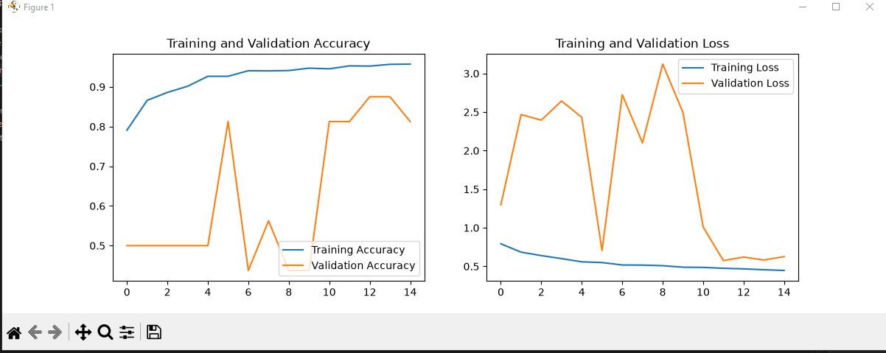

# 🩺 Medical AI: X-Ray Screener & Pneumonia Detection

โปรเจกต์นี้พัฒนาระบบเว็บแอปพลิเคชันปัญญาประดิษฐ์สำหรับคัดกรองโรคปอดบวม (Pneumonia) จากภาพถ่ายรังสีทรวงอก (Chest X-Ray) โดยใช้โมเดล Deep Convolutional Neural Network (DCNN) และรองรับการแสดงผลจุดที่โมเดลใช้ในการตัดสินใจด้วยเทคนิค **Grad-CAM (Gradient-weighted Class Activation Mapping)** พร้อมเชื่อมต่อระบบเข้ากับ Backend ของ PHP และ XAMPP

---

## 1. Project Overview (ภาพรวมโปรเจกต์)

โปรเจกต์เป็นการสร้างและปรับแต่งโมเดล DCNN สำหรับจำแนกภาพเอ็กซเรย์ปอดแบบ Binary Classification (ระหว่างภาวะปกติและปอดบวม) พร้อมสร้างระบบ Full-Stack ใช้งานจริงผ่านเว็บเบราว์เซอร์

**Features (คุณสมบัติเด่น):**
- ทำนายผลความเสี่ยงโรคปอดบวมพร้อมคำนวณค่าความมั่นใจ (Confidence Score) ของโมเดลแบบเรียลไทม์
- สร้างภาพฮีทแมปไฮไลต์จุดผิดปกติด้วย **Grad-CAM** (รองรับการทำงานร่วมกับ Keras 3 ภายใน `GradientTape`)
- เชื่อมต่อการทำงานแบบ Full-Stack ระหว่าง Frontend (HTML/TailwindCSS/JS), Backend (PHP via XAMPP/Apache) และ Machine Learning Server (Python)
- ดีไซน์หน้าจอ UI ทันสมัย สไตล์ระบบงานสาธารณสุขและการแพทย์

---

## 2. Dataset & Model Performance (ชุดข้อมูลและประสิทธิภาพโมเดล)

โมเดลถูกฝึกสอนและประเมินผลด้วยชุดข้อมูลภาพถ่ายเอ็กซเรย์ทรวงอกสำหรับจำแนกภาวะโรคปอดบวม

| ข้อมูลจำเพาะ | รายละเอียด |
|---|---|
| ประเภทงาน | Binary Classification (Normal vs. Pneumonia) |
| โครงสร้างโมเดล | Deep Convolutional Neural Network (DCNN) / Keras 3 |
| รูปแบบอินพุต | ภาพ Grayscale ขนาด 224x224 พิกเซล |

### 📊 ผลการประเมินประสิทธิภาพโมเดล (Model Evaluation)
- **Training & Validation Performance:** กราฟแสดงค่าความแม่นยำ (Accuracy) และค่าความสูญเสีย (Loss) ในระหว่างกระบวนการฝึกสอนโมเดล
  *(ใส่ภาพกราฟ Accuracy / Loss ไว้ที่นี่ เช่น `assets/accuracy-loss.png`)*
- **Confusion Matrix:** ตารางแสดงผลการทดสอบความแม่นยำในการจำแนกเคสปกติและโรคปอดบวมของโมเดล
  *(ใส่ภาพ Confusion Matrix ไว้ที่นี่ เช่น `assets/confusion-matrix.png`)*

---

## 3. Project Structure (โครงสร้างโปรเจกต์)

```text
X-Ray-Pneumonia-Detection/
├── DCNN_model.py       # สคริปต์สำหรับสร้างและกำหนดโครงสร้าง Deep CNN
├── data_loader.py      # จัดการการโหลดและเตรียมชุดข้อมูลภาพ X-Ray
├── evaluate.py         # ประเมินผลประสิทธิภาพของโมเดล
├── main.py             # สคริปต์หลักในการรันระบบหรือเทรนโมเดล
├── preprocessing.py    # จัดการการแปลงขนาด ปรับแต่ง และคลีนข้อมูลภาพ
├── server.py           # สคริปต์ Backend ทำนายผล และสร้างภาพฮีทแมป Grad-CAM
└── README.md           # เอกสารอธิบายรายละเอียดโปรเจกต์
```
---

## ผลการวิเคราะห์ (Analysis Results)

ผลการทดสอบการใช้งานระบบผ่านเว็บเบราว์เซอร์ ในการจำแนกภาพถ่ายรังสีทรวงอก (Chest X-Ray) ทั้งในกรณีปกติและกรณีพบภาวะปอดบวม (Pneumonia):

### 1. เคสพบความผิดปกติ (Pneumonia Detection)
ระบบแสดงผลการวินิจฉัยพร้อมค่าความมั่นใจสูง และแสดงภาพฮีทแมป (Grad-CAM) ไฮไลต์บริเวณจุดที่ AI ใช้ในการตัดสินใจ:
.png)

### 2. เคสปกติ (Normal Screen)
ระบบแสดงผลการวินิจฉัยสถานะปกติ พร้อมคำนวณค่าความมั่นใจของฝั่งปกติอย่างแม่นยำ:

